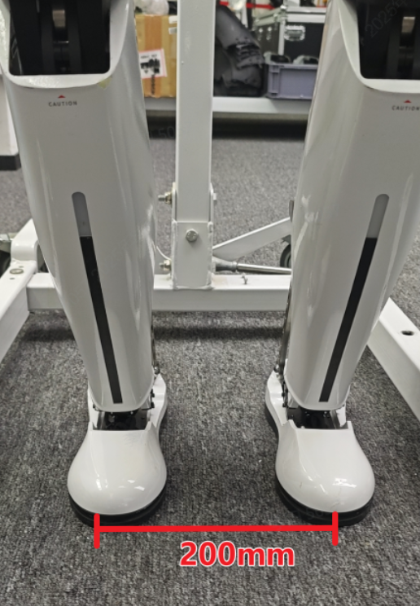
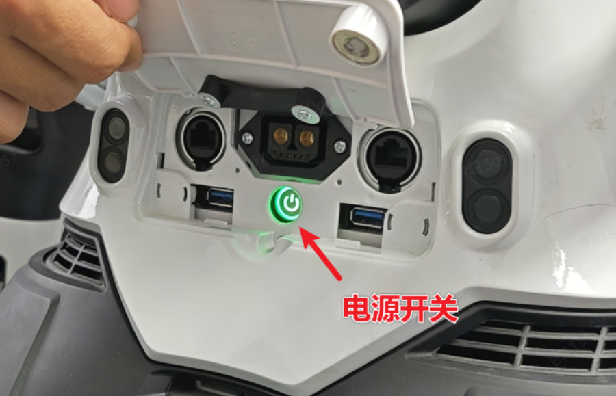
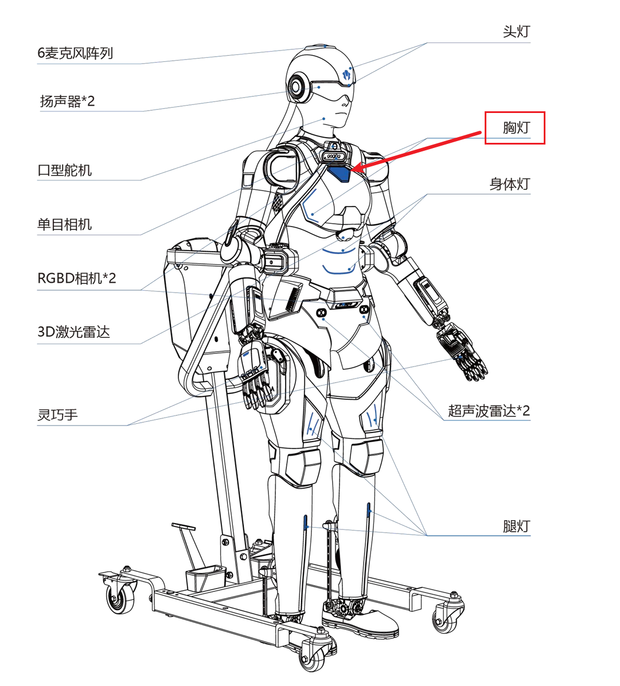

> **适用产品**：墨茵机器人 本文覆盖开机前检查、开机操作、关机流程及安全注意事项。

## 1 开机

### 1.1 开机前检查

<Note>
  确保机器人放置于待机站上。
</Note>

#### 1.1.1 检查电池安装与电量

- 检查电池安装牢固，确认推入到位，锁定无松动。
- 检查电量充足，确认电量 ≥60%（三格灯亮）。

#### 1.1.2 放置双足

- 将机器人从待机站脚蹬上取下。
- 手动将双足放置于地面。
- 两脚间距 200 mm 左右，确保平稳。

### 1.2 开机操作

#### 1.2.1 启动电源

- 长按机器人电源开关，等待电源开关指示灯变绿。

#### 1.2.2 等待启动

- 等待约 3 分钟。
- 机器人自动进入曲腿站立模式。
- 听到“大脑服务启动成功”播报。
- 胸口指示灯亮起。

## 2 关机

<Note>
  关机前必须将机器人放置于待机站上，并按顺序切换模式：直腿行走 → 放置待机站 → 直腿站立 → 曲腿站立。
</Note>

### 2.1 放置待机站

- 确保机器人放置于待机站。
- 确保机器人已切换至曲腿站立模式。

### 2.2 执行关机

- 短按一下电源键，紧接着长按。
- 等待约 1 秒，此时电源开关指示灯熄灭。

<Note>
  若关机无效，等待 10 s 后再进行操作。
</Note>

### 2.3 确认关机

- 全身指示灯熄灭。
- 机器人各关节瘫软，进入关机状态。

## 3 安全注意事项

<Warning>
  危险：

  - 严禁在直腿行走或直腿站立模式下直接断电。
</Warning>

<Warning>
  警告：

  - 开机前确保电量 ≥60%，低于 20% 禁止启动。
  - 关机时必须有待机站支撑，防止倾倒。
</Warning>

<Note>
  注意：

  - 开机后自动进入曲腿模式，无需手动切换。
  - 指示灯异常或无播报时，重新启动或联系售后。
  - 开机完成后将机器人头发移至背部，避免遮挡摄像头。
</Note>
