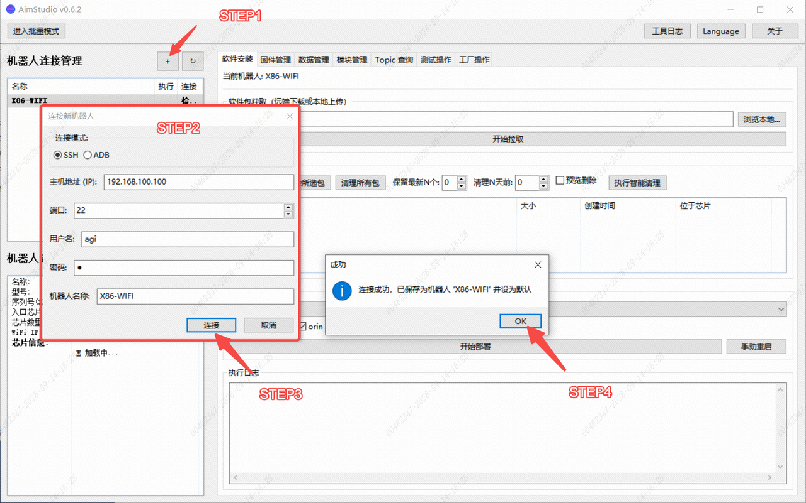
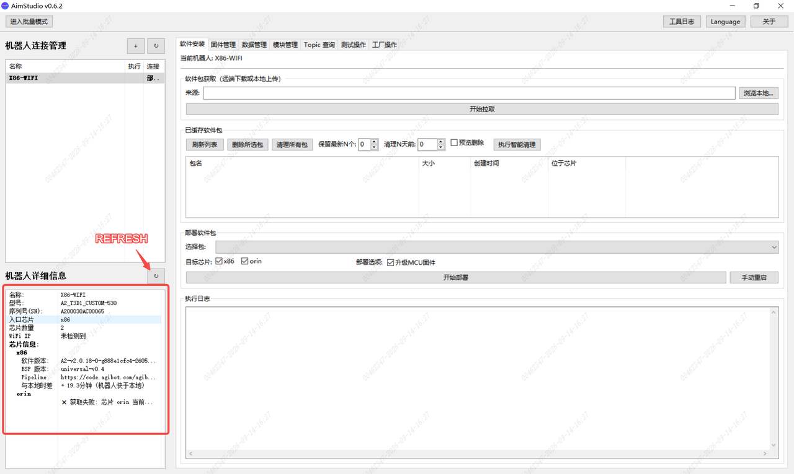
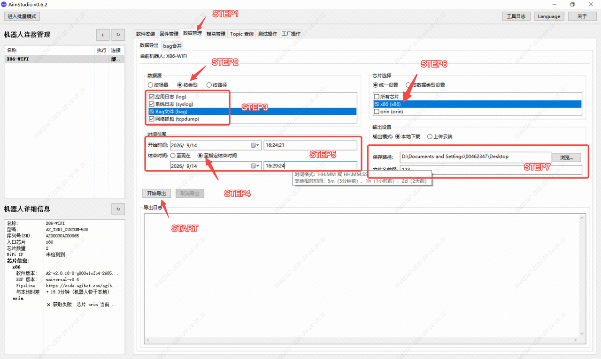
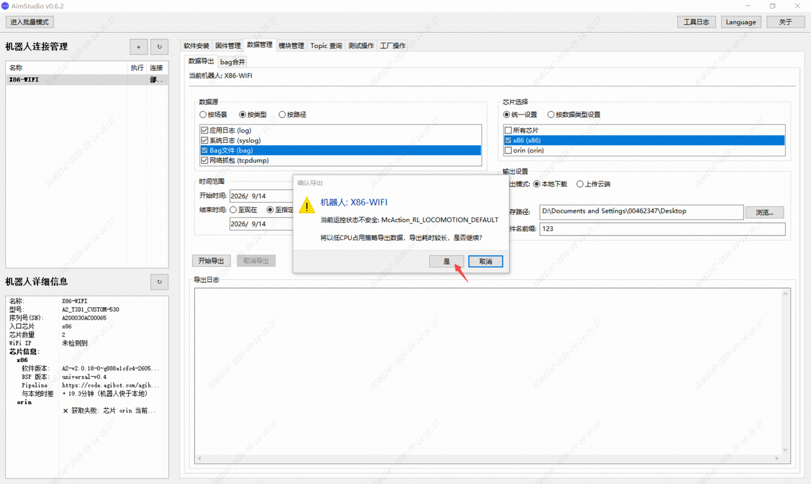
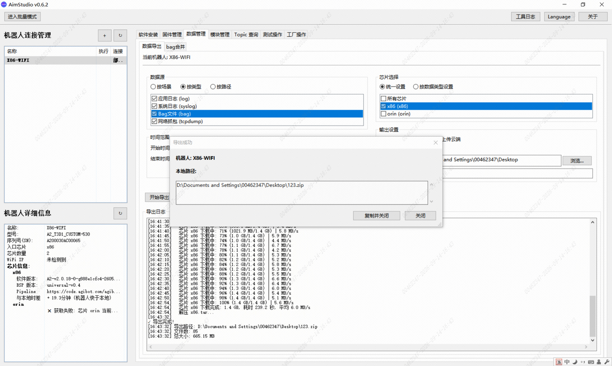
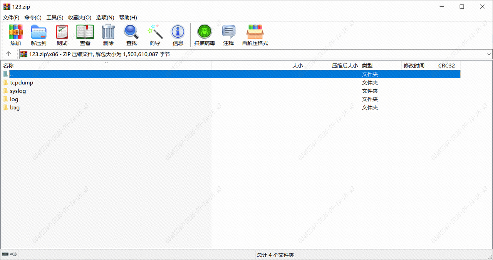

> **适用产品**：墨茵机器人<br />本文覆盖 X86 运动控制器日志的适用故障场景、准备工作及抓取操作步骤。

## 1 适用故障场景

X86 运动控制器日志主要用于抓取机器人运动相关的异常信息，适用于以下故障场景：

- 机器人上肢动作异常（机械臂不动作、轨迹偏差、抖动等）
- 机器人摔机或姿态失控
- 机器人电机报警（过流、过温、编码器异常等）
- 运动控制器无法初始化或启动失败
- 其他与运动控制相关的异常

## 2 准备工作

- 硬件工具：网线（有线连接方式）或已连接机器人无线网络的电脑。
- 软件工具：[AimStudio 日志抓取工具](https://drive.weixin.qq.com/s?k=AHYAsQcTADcNovdfVu)`AimStudio-0.6.2-windows.exe`。
- 网络信息：
  - 有线连接：网口 IP `192.168.2.50`（机器人腰部后侧左边网口）。
  - 无线连接：Wi-Fi IP `192.168.100.100`。
- 登录凭据：
  - 用户名：`agi`。
  - 密码：`1`。

<Tip>
  建议：优先使用有线连接，传输更稳定快速。
</Tip>

## 3 操作步骤

### 3.1 连接机器人

- 先使用网线将电脑与机器人腰部后侧左边网口相连，或确保电脑已连接机器人发出的 Wi-Fi 网络。
- 再打开 AimStudio 软件。
- 在软件界面中输入对应的 IP 地址，点击“连接”按钮，等待连接成功。



### 3.2 查看机器人详细信息

- 连接成功后，点击刷新按钮，查看 X86 控制器的详细信息。

> 

### 3.3 抓取日志

> 

- 先点击数据管理，选择数据导出，进入日志导出界面。
- 在数据源中选择按类型，勾选所有的日志数据类型。
- 时间范围选择至指定时间，按照北京时间输入需要抓取的日志的开始时间到结束时间（不考虑 X86 控制器系统时间与本地的时差）。
- 抓取时间范围不宜过长，bag 数据文件较大，单次建议 **≤ 20 分钟**。
- 芯片选择 X86，仅抓取本体骨架的日志。
- 在输出模式中选择本地下载，输入保存目录以及文件名称。
- 最后点击开始导出，等待日志与输出文件导出。

> 
>
> 

- 导出完成后，对应文件目录可以查看日志包，解压后如下。

> 

## 4 备注

下方为SSH通讯连接到X86控制器后，log与bag数据抓取的原始命令

```Plain
aima log export --since '2025-12-31 14:05' --until '2025-12-31 14:15'
aima bag export --since '2025-12-31 14:08' --until '2025-12-31 14:16'
```
