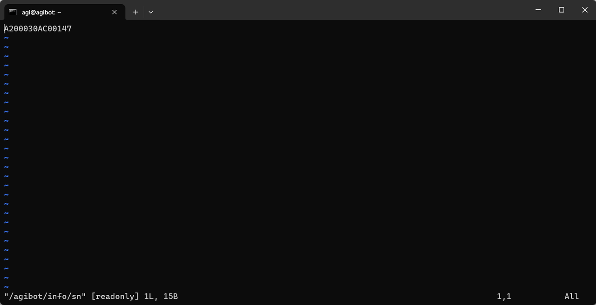

> **适用产品**：墨茵机器人<br />本文覆盖连接机器人网络、SSH 通讯访问运控及查看骨架 SN 文件。

## 1 连接机器人网络

机器人 X86 运动控制器支持通过无线网络或者有线网口访问，一般通过无线网络直接访问。

- 连接机器人的 Wi-Fi。

## 2 SSH 通讯访问

- 输入命令行访问运控，并查看文件。
  ```text
  //访问运控
  ssh agi@192.168.100.100
  //密码：1
  //查看骨架sn
  vi /agibot/info/sn
  ```

示例：

- SN 为：`A200030AC00147`


