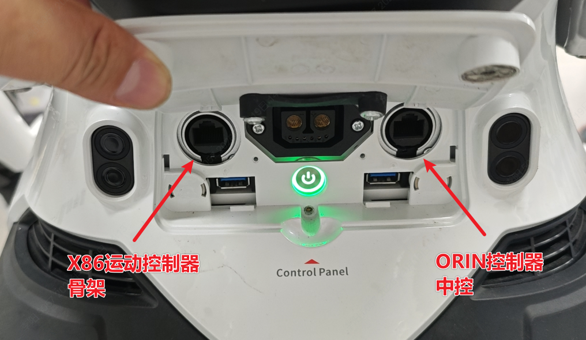

> **适用产品**：墨茵机器人<br />本文覆盖运控 X86 的无线网络访问、中控跳转访问、有线网络访问及网口位置说明。

## **1 机器人运控 X86 控制器**

机器人运控支持通过无线网络直接访问，以及通过有线网络访问。

```text
//////////////////无线网络、中控跳转////////////////////
//IP地址：
192.168.100.100
//用户名：
agi
//密码：
1
//SSH通讯连接命令：
ssh agi@192.168.100.100

//////////////////有线网络////////////////////
//IP地址：
192.168.2.50
//用户名：
agi
//密码：
1
//SSH通讯连接命令：
ssh agi@192.168.2.50
```

## **2 有线网络连接说明**

- 机器人有线网络通讯使用机器人腰后部的网口。
- 左侧为 X86 运动控制器的连接网口，IP 地址为 `192.168.2.50`。


