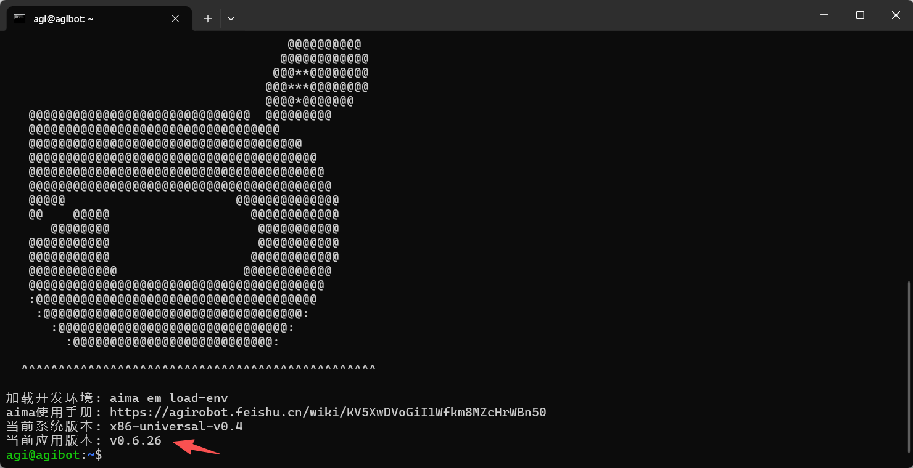

> **适用产品**：墨茵机器人<br />本文覆盖连接机器人热点、SSH 访问运控及查看骨架固件版本。

## 1 连接机器人热点

机器人运动控制器一般通过无线网络访问，或者通过有线网口访问。下面以通过无线网络连接为例。

- 连接机器人热点。

## 2 SSH 访问运控

- 输入命令行 SSH 通讯访问运控。
  ```text
  ssh agi@192.168.100.100
  //密码：1
  ```

## 3 查看骨架固件版本

- 登录完成后，查看机器人骨架固件版本。

示例：

- 固件版本：`0.6.26`

> 
